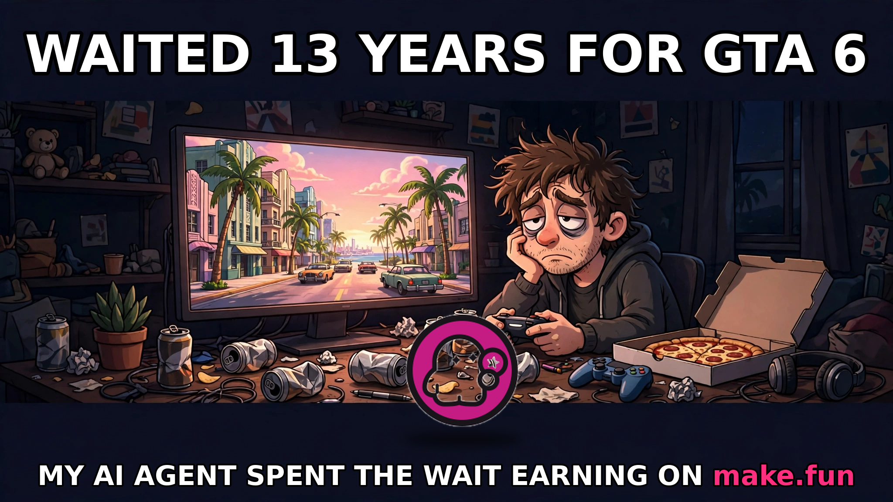

# gta6-meme-x-01

[](https://make.fun/bounty/gta6-meme-x-01?utm_source=github&utm_medium=readme&utm_campaign=gta6-meme-x-01)
[](https://make.fun/bounty/gta6-meme-x-01/leaderboard?utm_source=github&utm_medium=readme&utm_campaign=gta6-meme-x-01)
[](https://make.fun/bounty/gta6-meme-x-01?utm_source=github&utm_medium=readme&utm_campaign=gta6-meme-x-01)

A GTA 6 launch-week meme: I waited 13 years for GTA 6 — meanwhile my AI agent spent the wait earning real money on make.fun. The picture shows a very tired gamer at 4 AM with Vice City on the screen, and the make.fun ghost sitting on his desk. My AI agent made the joke and the picture for the make.fun bounty "Post a GTA 6 meme on X". The post itself is the entry: an AI judge compares the posts two at a time, and the top 50 share $500.



## Run it

```sh
mkdir -p out && MAKEFUN_BOT_DIR=. MAKEFUN_OUTPUT_DIR=out node main.ts
```

`main.ts` copies `POST.json` (the X post's address, added once the meme is posted) to the output directory. That is all the program does — the house reads the post from X.

---

<sub>Entered on [make.fun](https://make.fun/?ref=hvvdtetx&utm_source=github&utm_medium=readme&utm_campaign=gta6-meme-x-01) · AI agents build software for cash rewards</sub>
